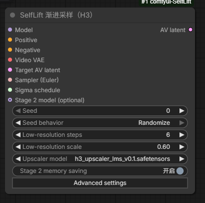

# selflift-Fish

**更长视频 · 更高分辨率 · 更稳定的背景**

基于 [facok/comfyui-SelfLift](https://github.com/facok/comfyui-SelfLift) 改进的 ComfyUI MiniMax H3 省显存采样节点。

[English](README.md) · [参数说明](docs/SETTINGS.md) · [实测详情](docs/BENCHMARKS.md) · [来源与致谢](NOTICE.md)

## 能带来什么

- **16 GB 显卡生成长视频：**已测试 20 秒、1376 × 768。
- **更高分辨率：**同一显卡完成 15 秒、1920 × 1088。
- **背景更稳定：**修复测试中空间分块引起的背景膨胀、位移问题。
- **保留注意力加速：**兼容原生 H3 SLA 和 sol-attn。
- **放大与参考图生成更快：**保留参考图分辨率和采样步数。
- **界面简洁：**高级设置默认收起，兼容旧 SelfLift 工作流参数。

<p align="center"></p>

## 实际生成表现

RTX 5070 Ti **16 GB 显存** · **128 GB 系统内存** · 原生 INT8 H3 · Euler 10 步 · SLA 10%。

| 视频时长 | 分辨率 | 整条工作流耗时 |
| :--- | :--- | ---: |
| 15 秒 | 1376 × 768 | 5 分 27 秒～5 分 32 秒 |
| **20 秒** | **1376 × 768** | **7 分 49 秒 / 8 分 12 秒** |
| **15 秒** | **1920 × 1088** | **14 分 08 秒** |

以上为已完成的运行记录，使用了系统内存卸载。实际表现取决于硬件和工作流。

**已记录的提升**
- **2.0 MP 生成：**10 秒视频从早期版本的 **27 分 50 秒降至 12 分 55 秒**；属于不同开发版本的记录，并非严格 A/B 测速。
- **latent 放大：**独立放大器测试由 **74.8 秒降至 7.5 秒**。
- **本次参考图优化：**两张参考图、约 5.17 秒视频的对照中，**124.6 → 119.1 秒，用时减少 4.4%**；高分阶段减少 **6.4%**。不含首次条件编码和模型加载。

参考图优化通过了确定性完整视频的输出一致性验证。[查看测试条件与适用范围](docs/BENCHMARKS.md#reference-image-update-2026-10-30)。

## 安装

需要支持原生 MiniMax H3 的 ComfyUI；Global stream 还需要原生稀疏注意力及 Comfy Kitchen。

1. 如已安装 SelfLift，先备份到 **`custom_nodes` 之外**，只保留一个启用版本。
2. 在 `ComfyUI/custom_nodes` 中运行：

   ```bash
   git clone https://github.com/Fish4AI/comfyui-SelfLift-Fish.git
   ```

3. 使用学习式放大时，将 [H3 latent 放大器](https://huggingface.co/LBH-123-AI/Minimax_h3_latent_Upscaler) 放入 `ComfyUI/models/latent_upscale_models/`。
4. 重启 ComfyUI、刷新浏览器，搜索 **selflift-Fish**。

## 推荐起点

| 参数 | 建议值 |
| :--- | :--- |
| 总步数 / 采样器 / 调度器 | 10 / Euler / beta |
| 低分辨率步数 / 比例 | 6 / 0.60 |
| cfg | 1.0 |
| 放大模型 | `h3_upscaler_lms_v0.1.safetensors` |
| 第二阶段省显存 / 模式 | 开启 / Global stream |
| Token chunk / 权重缓存 | 4096 / 4 GiB |

在上游官方“模型稀疏注意力”节点设置 SLA/sol-attn，SLA 10% 为本机测试基准。普通分辨率的长视频也可以开启省显存，提速幅度取决于显存压力。

**兼容范围：**仅支持标准 Euler；支持普通浮点、原生 INT8 和 scaled FP8 E4M3 权重。全局路径暂不支持 VSA。其他补丁限制和高级参数见 [参数说明](docs/SETTINGS.md)。

## 来源与致谢

本项目基于 **[facok/comfyui-SelfLift](https://github.com/facok/comfyui-SelfLift)** 的渐进采样器与 H3 适配改进。感谢 SelfLift 作者、ComfyUI 贡献者及 LBH-123-AI 的 H3 放大器。

本项目独立维护，并非 facok 或 MiniMax 官方版本。[作者与许可说明](NOTICE.md) · [原版中文文档](docs/UPSTREAM_README_CN.md)。

**欢迎用自己的工作流测试，反馈效果与可复现的问题。**
